<div align="center">

<a href="https://govbus-tamilnadu.vercel.app"></a>

# GovBus — Tamil Nadu Government Bus Route, Ticketing & Live Tracking

**Search buses between any two towns · book seats on a live seat map · pay · get a QR e-ticket · watch your bus move on the map.**
English & தமிழ் · four Tamil Nadu landscape themes · 3D animated UI · built for every age group.

<a href="https://govbus-tamilnadu.vercel.app"></a>
<a href="https://govbus-tamilnadu.vercel.app/?from=Chennai&to=Ooty"></a>
<a href="https://govbus-tamilnadu.vercel.app/departures?place=Madurai"></a>


</div>

---

## 🎮 Try it live: click any row

| | Try this in the live demo | What you'll see |
|---|---|---|
| 🔍 | [**Chennai → Madurai**](https://govbus-tamilnadu.vercel.app/?from=Chennai&to=Madurai) | Ordinary, Express, AC and Sleeper buses with times, fares and seats left. Filter by time of day, sort by cheapest or fastest. |
| 🔁 | [**Chennai → Ooty**](https://govbus-tamilnadu.vercel.app/?from=Chennai&to=Ooty) | No direct bus, so GovBus plans the trip with a change at Coimbatore, with the wait time and a book button for each bus. |
| 🛕 | [**கோவை → Rameswaram**](https://govbus-tamilnadu.vercel.app/?from=%E0%AE%95%E0%AF%8B%E0%AE%B5%E0%AF%88&to=Rameswaram) | Type in Tamil or use nicknames (Kovai, Trichy, Pondy). Typos are forgiven too. |
| 🚏 | [**Madurai departure board**](https://govbus-tamilnadu.vercel.app/departures?place=Madurai) | An LED-style bus-stand board with a live clock and split-flap rows. |
| 💺 | [**Pick a sleeper berth**](https://govbus-tamilnadu.vercel.app/?from=Chennai&to=Madurai) → *AC Sleeper* → *Select seats* | 3D seat map with lower and upper decks, window markers and seats that flip when picked. |
| 🧑‍✈️ | [**Driver / Conductor portal**](https://govbus-tamilnadu.vercel.app/driver/login) | Log in as the demo driver (see [Demo accounts](#5-demo-scenario-about-5-minutes)), tap **Simulate trip**, then watch the bus on the passenger's map. |
| 🆘 | The red **SOS** button on any screen | One tap to call 112 / 181 / 108 or share your live location. |
| 🎨 | The 🌿 button in the header | Switch between the four Tamil Nadu landscapes. |

> The live demo runs in **demo mode**: an in-memory Postgres (PGlite) inside the serverless function, filled with sample routes. One-time codes show on screen, and bookings can disappear when Vercel starts a fresh instance. Point `DATABASE_URL` at Supabase to make it permanent (see [Deploy to Vercel](#deploy-to-vercel)).

## 🛣️ How it works


## 🎨 Four Tamil Nadu landscapes

Every screen re-colours itself to the landscape you pick. The hero scene is drawn in SVG and animated: drifting mist, rolling waves, a sweeping lighthouse beam, swaying palms and a 3D bus on the road (tap it to spin).

<table>
  <tr>
    <td width="50%">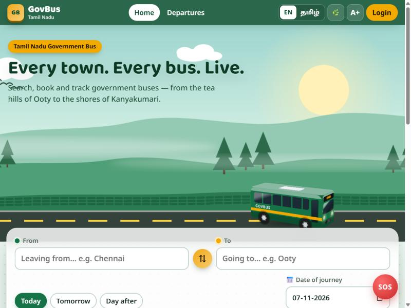<br><b>🌿 Nilgiri Hills</b>: tea rows, pines, mist</td>
    <td width="50%">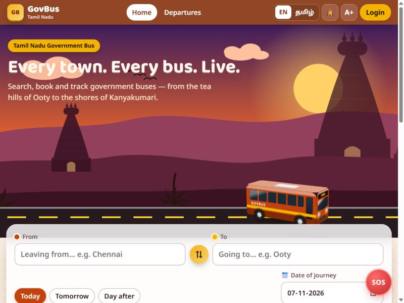<br><b>🛕 Temple Dusk</b>: gopurams at sunset</td>
  </tr>
  <tr>
    <td>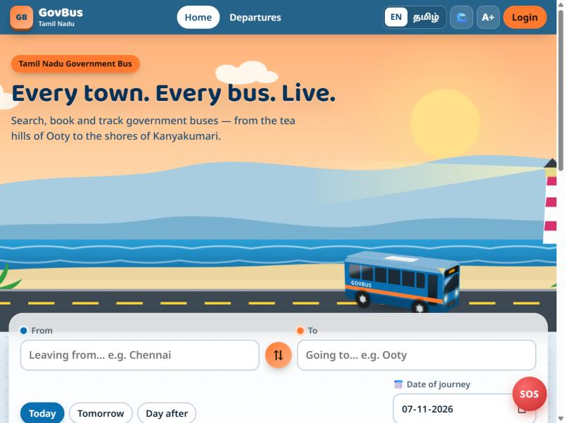<br><b>🌊 Marina Coast</b>: sea, lighthouse, palms</td>
    <td>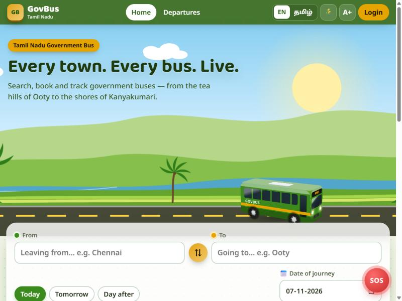<br><b>🌾 Kaveri Delta</b>: paddy, river, coconut palms</td>
  </tr>
</table>

## 🔁 No direct bus? GovBus finds the change

<table>
  <tr>
    <td width="42%"></td>
    <td width="58%">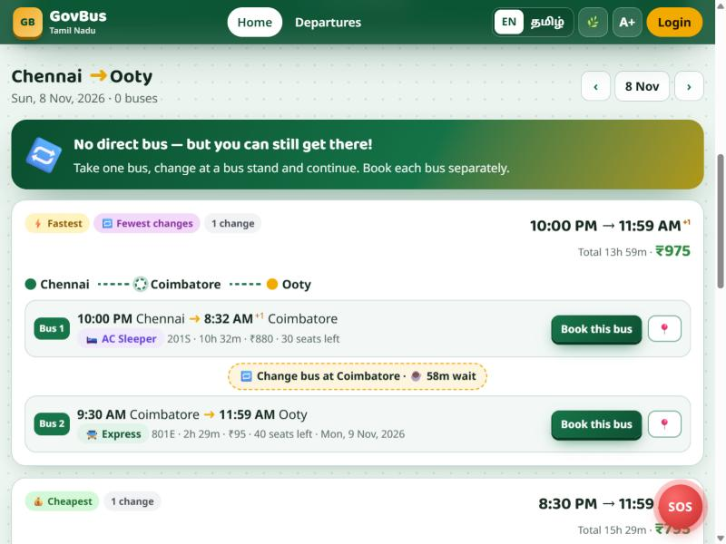<br>
    When no single bus goes all the way, search builds journeys with <b>1–2 changes</b> through bus stands served by several routes. It drops backtracking routes and ranks options by door-to-door time, with badges for <i>⚡ Fastest</i>, <i>💰 Cheapest</i>, <i>🏁 Arrives first</i> and <i>🔁 Fewest changes</i>.</td>
  </tr>
</table>

## 📸 Feature tour: click to expand

<details>
<summary><b>💺 Live 3D seat map</b>: sleeper decks, window seats, real-time holds</summary>
<br>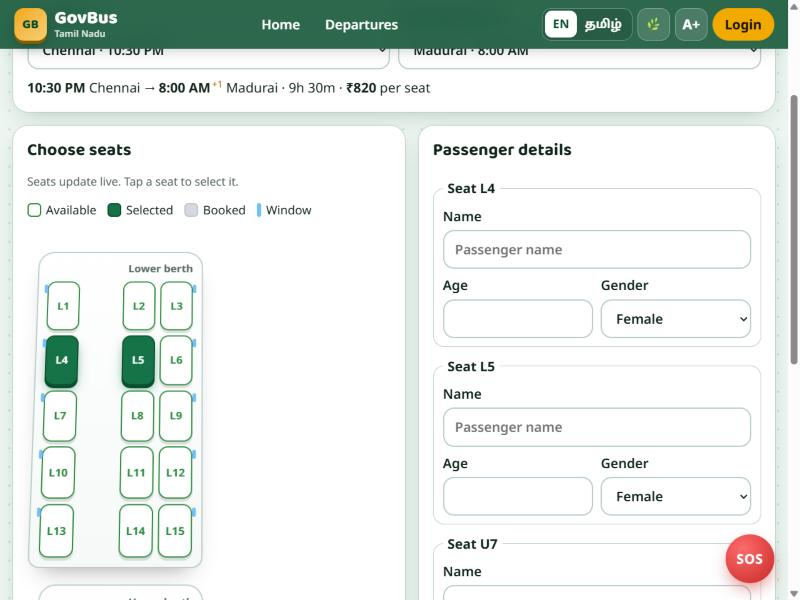<br>
Seats are held for 10 minutes while you pay and turn grey on everyone's screen at once (WebSockets locally, polling on Vercel). Two people can't buy the same seat: the rows are locked in a database transaction.
</details>

<details>
<summary><b>📍 Live GPS tracking</b>: bus on the map, ETA to every stop</summary>
<br>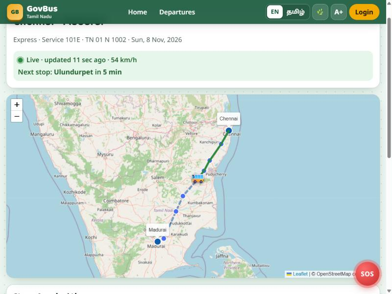<br>
The driver's phone shares GPS (or a simulated drive). The server places the bus on the route and works out the arrival time at every remaining stop.
</details>

<details>
<summary><b>🚏 LED departure board</b>: every bus leaving a bus stand</summary>
<br>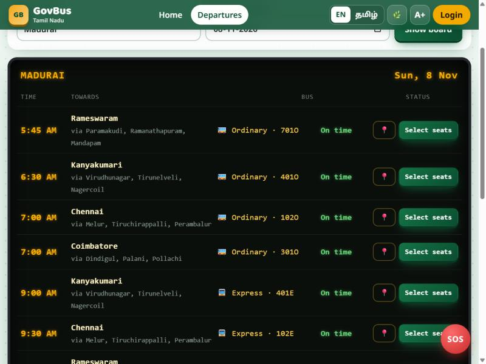
</details>

<details>
<summary><b>📱 Phone + தமிழ்</b>: bottom navigation, big text, Tamil UI</summary>
<br>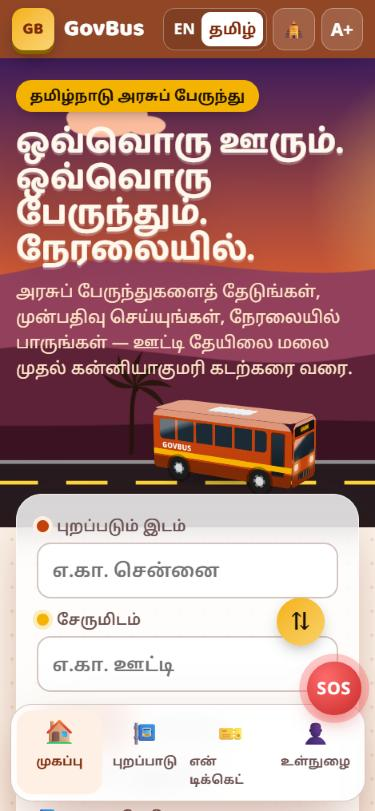
</details>

---

## What's inside

A mobile-friendly web app for government bus passengers, crew and depot admins:

| Role | What they can do |
|---|---|
| **Passenger** | Sign up / log in (email or mobile + password, one-time code by SMS/email, or Google) · search buses between any two stops · see timings, duration and fares for Ordinary / Express / AC / Sleeper · choose seats on a live seat map · pay (mock gateway) · get an e-ticket with QR by SMS + email · track the bus live with ETAs · view history, cancel, see refund status |
| **Driver / Conductor** | Separate login portal (OTP or Google), only for crew registered by admin · pick today's trip · share phone GPS (or simulate a drive) · verify tickets by QR scan or PNR · mark passengers boarded |
| **Admin** | Add/deactivate routes (with stops), buses, schedules, fares · register drivers and assign buses · see totals |

The design is readable for all ages: big buttons, 17px base text with an **A+** large-text toggle, 12-hour clock times and simple wording.

### Look & feel
- **Four Tamil Nadu landscape themes**, switched from the 🌿 button in the header: *Nilgiri Hills* (tea rows, pines, drifting mist), *Marina Coast* (sea waves, lighthouse beam, boat, palms), *Temple Dusk* (gopuram silhouettes at sunset) and *Kaveri Delta* (paddy fields, river, coconut palms). Every screen's colours follow the chosen theme.
- **3D and motion**: a CSS 3D bus on the hero road (tap it to spin) with spinning wheels and glowing headlights, mouse parallax on the landscape, 3D tilt and glare on cards, a flip-card e-ticket (details on the front, QR on the back), split-flap style rows on the departure board, and seats that flip when selected. Everything respects "reduce motion".
- **English / தமிழ்** toggle for the main passenger screens. Search also understands Tamil place names, nicknames ("Trichy", "Kovai", "Pondy") and small typos.
- App-style bottom navigation on phones.

### Extra features
- **Connecting journeys**: when there is no direct bus, search suggests routes with 1–2 changes ("Chennai → Coimbatore, change bus at Coimbatore (58 min wait), Coimbatore → Ooty"). Each option shows waits, total time and fare, with badges for *Fastest*, *Cheapest*, *Arrives first* and *Fewest changes*, and a book button for every leg.
- Result **filters and sorting**: bus type, time of day (morning / afternoon / evening / night), and sort by earliest, cheapest, fastest or most seats. Previous/next day buttons, amenities per bus, and a seat-availability bar.
- **Live departure board** for any bus stand (LED style, with a live clock).
- **PNR status** check without logging in (no personal details shown).
- **Safety SOS** button on every screen: call 112 / 181 (women's helpline) / 108, or share a live-location link.
- Scenic trip cards, recent searches, bus-type guide, concessions info, window-seat markers, share ticket, and add to calendar (.ics with a 1-hour reminder).
- 8 corridors / 16 routes / 37 towns in the demo data: Chennai, Madurai, Coimbatore, Ooty, Kanyakumari, Rameswaram, Puducherry (ECR), Velankanni (Kaveri delta) and more.

More documentation:
- [docs/DATABASE.md](docs/DATABASE.md): database schema and ER diagram
- [docs/API.md](docs/API.md): every API endpoint
- [server/src/db/schema.sql](server/src/db/schema.sql): the SQL to run in Supabase

---

## 1. Architecture

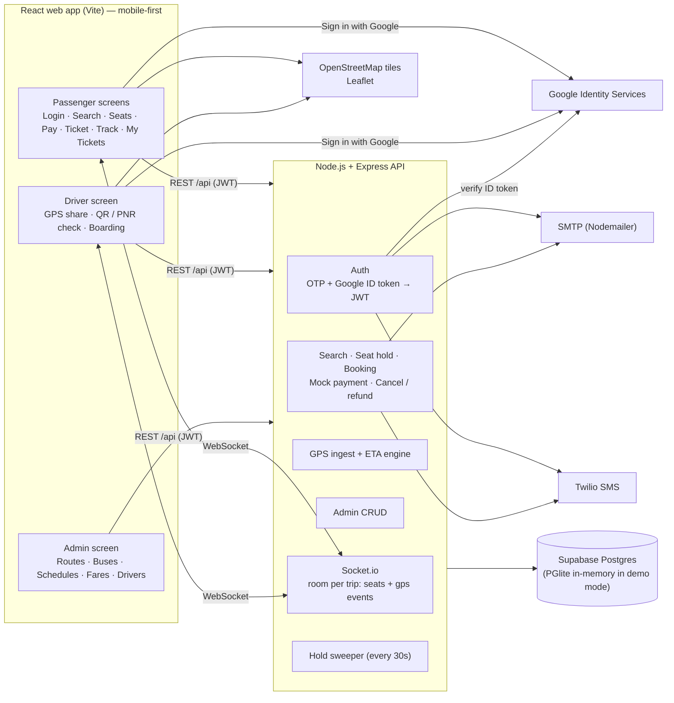

How the main flows work:

1. **Login**, three ways:
   - **Password**: sign up with name + email or mobile + password. A 6-digit code confirms the email or mobile is yours (`/auth/otp/send` with `purpose: "register"`, then `/auth/password/register`). Log in with `/auth/password/login`. **Forgot password** sends a reset code (`purpose: "reset"`) and `/auth/password/reset` sets a new one. This also lets OTP/Google users add a password. Passwords need 8+ characters with a letter and a number, and are hashed with scrypt.
   - **One-time code**: `POST /auth/otp/send` stores an HMAC of a 6-digit code (5 min expiry, 5 tries, 5 sends per 15 min) and sends it by SMS (Twilio) or email (Nodemailer). `POST /auth/otp/verify` issues a 7-day JWT. Google: the browser gets an ID token from Google Identity Services and `POST /auth/google` verifies it with `google-auth-library`.
   - **Passenger portal** (`/login`): a first login creates a passenger account (that is the sign-up).
   - **Driver portal** (`/driver/login`): login works only if an admin has registered that email/phone as a driver. A Google login with an unregistered email is refused.
2. **Search**: finds schedules whose route contains *From* before *To* and that run on that weekday. Fare = full-route fare for that bus type × (segment km ÷ route km).
3. **Booking**: `POST /bookings` locks the seat rows (`SELECT … FOR UPDATE`), holds them for 10 minutes and broadcasts the new seat map to everyone viewing that trip. Mock payment confirms the booking, then the e-ticket (signed QR) goes out by email + SMS. Unpaid holds are released by a background sweeper.
4. **Tracking**: the driver's phone posts GPS every 5 s. The server projects the point onto the route, computes ETAs to every remaining stop and pushes `gps` events to the trip room. Passengers see the bus move on a Leaflet/OSM map.

**Demo mode**: if `DATABASE_URL` is empty, the server runs real Postgres in-memory (PGlite, Postgres compiled to WebAssembly), applies `schema.sql` and seeds sample data. The same SQL runs on Supabase, so there is no second code path. OTP codes, emails and SMS are shown on screen and printed to the console instead of being sent.

---

## 2. Database schema

Tables: `users`, `otp_codes`, `routes`, `stops`, `buses`, `fares`, `schedules`, `bookings`, `seats`, `payments`, `gps_locations`.
See [docs/DATABASE.md](docs/DATABASE.md) for the ER diagram and column notes, and [schema.sql](server/src/db/schema.sql) for the DDL.

---

## 3. Folder structure

```
Bus tracker/
├── package.json              # root scripts: install:all, dev (runs both apps)
├── vercel.json               # Vercel build, serverless API function, rewrites
├── api/index.js              # Vercel serverless entry → server/src/app.js
├── README.md
├── docs/
│   ├── API.md                # endpoint reference
│   ├── DATABASE.md           # schema + ER diagram
│   ├── assets/               # animated SVGs used in this README
│   └── screenshots/          # screenshots used in this README
├── server/                   # Node.js + Express API
│   ├── .env.example
│   ├── package.json
│   └── src/
│       ├── app.js            # Express app (routes, errors), shared with Vercel
│       ├── index.js          # long-running server: app + Socket.io + hold sweeper
│       ├── config.js         # env settings, demo-mode switch
│       ├── db/
│       │   ├── schema.sql    # tables (run in Supabase SQL editor)
│       │   ├── seed.js       # sample routes, buses, schedules, fares, demo users
│       │   ├── setup.js      # npm run db:setup → schema + seed on Supabase
│       │   ├── seed.sql      # sample data as SQL (paste into the Supabase SQL editor)
│       │   ├── export-seed.js # npm run db:export-seed → regenerates seed.sql
│       │   └── index.js      # pg (Supabase) / PGlite (demo) query + transaction helpers
│       ├── middleware/auth.js    # JWT sessions, role guard, async wrapper
│       ├── routes/
│       │   ├── auth.js       # OTP send/verify, Google, /me
│       │   ├── public.js     # places, search, trip seats, live tracking
│       │   ├── bookings.js   # hold/book, history, cancel+refund, mock payments, hold sweeper
│       │   ├── driver.js     # trips, GPS ingest, passenger list, boarding / QR verify
│       │   └── admin.js      # routes+stops, buses, schedules, fares, drivers, stats
│       └── services/
│           ├── connections.js # connecting journeys (1–2 changes) + departure board
│           ├── places.js     # Tamil names, nicknames, typo-tolerant place matching
│           ├── geo.js        # distance, route projection, ETAs
│           ├── trips.js      # fares, timings, seat layouts, seat inventory
│           ├── tickets.js    # booking details, signed QR, ticket email/SMS
│           ├── notify.js     # Nodemailer + Twilio (or console/dev outbox)
│           ├── realtime.js   # Socket.io rooms per trip
│           └── time.js       # local-time (IST) helpers
└── client/                   # React (Vite) web app
    ├── .env.example
    ├── index.html
    ├── vite.config.js        # dev proxy /api + /socket.io → :4000
    └── src/
        ├── main.jsx, App.jsx # routes
        ├── api.js            # fetch wrapper with JWT
        ├── auth.jsx          # auth context + route guard
        ├── socket.js         # useTripChannel() realtime hook
        ├── utils.js, styles.css
        ├── prefs.jsx, i18n.js # theme + language + text size; English/Tamil strings
        ├── components/       # Header, Scenery (SVG landscapes), Bus3D, Tilt, SOS,
        │                     # GoogleButton, SeatMap, LiveMap
        └── pages/            # Login, Search (home + results + connections), Departures,
                              # SeatSelect, Payment, Ticket, MyBookings, Track, Driver, Admin
```

---

## 4. Setup and run

### Requirements
- Node.js 20 or newer (`node --version`). On this PC a portable Node 26 is installed at
  `%LOCALAPPDATA%\Programs\node-portable\node-v26.13.0-win-x64`. Add that folder to your user `PATH` (or install Node from nodejs.org) so `node` and `npm` work in any terminal.
- Optional: a Supabase project, a Google OAuth client, SMTP credentials, a Twilio account

### Quick start (demo mode, no accounts needed)

```bash
npm install
```
```bash
npm run install:all
```
```bash
npm run dev
```

Open http://localhost:5173. The API runs on http://localhost:4000. Demo data resets every time the server restarts.

### This project's Supabase database (already set up)
A Supabase project named **GovBus** (ref `xupqmygrnluvzhllsrxy`, region Mumbai `ap-south-1`) already has all tables, indexes, RLS and the sample data (16 routes, 90 stops, 56 buses, 56 fares, 56 schedules, admin + driver accounts). To switch the app from demo mode to it:
1. Supabase dashboard → **GovBus** → Project Settings → Database → **Reset database password** (the project was created by the connector, so nobody knows the current one).
2. Open `server/.env`. In the `# DATABASE_URL=…` line, replace `[YOUR-PASSWORD]` with that password (URL-encode characters such as `@ # / ?`) and delete the leading `# `.
3. Save, then stop and re-run `npm run dev`. The API console no longer says "DEMO MODE", and data now survives restarts.

The staff accounts in Supabase have no password yet. Log in with the **One-time code** tab, or use **Forgot password?** to set one.

### Connect your own Supabase project (persistent data)

1. Create a project at supabase.com.
2. Copy `server/.env.example` to `server/.env`.
3. In Supabase go to **Connect → Connection string → Session pooler** and paste it as `DATABASE_URL` (replace `[YOUR-PASSWORD]`).
4. Create the tables and sample data:
   ```bash
   npm run db:setup --prefix server
   ```
   Or paste [`schema.sql`](server/src/db/schema.sql) and then [`seed.sql`](server/src/db/seed.sql) into the Supabase SQL editor. `seed.sql` is generated from the sample data by `npm run db:export-seed --prefix server`, and running it twice is safe.
5. Set a long random `JWT_SECRET` and restart `npm run dev`.

All tables have Row Level Security enabled with no policies, so the public Supabase REST API can't touch them. Only the backend, through its direct Postgres connection, can.

### Enable Google Sign-In (passengers and drivers)

1. In Google Cloud Console go to **APIs & Services → Credentials → Create OAuth client ID → Web application**.
2. Add the authorised JavaScript origin `http://localhost:5173` (plus your production URL later).
3. Put the client ID in **both** `server/.env` (`GOOGLE_CLIENT_ID`) and `client/.env` (`VITE_GOOGLE_CLIENT_ID`).
4. Restart. The passenger login and the driver login each show their own Google button:
   - Passenger Google login creates the account automatically.
   - Driver Google login only works for an email an admin has registered under **Admin → Drivers**.

Without a client ID, a **demo Google sign-in** (type a Gmail address) appears so the flow can still be tried locally. It is disabled when `NODE_ENV=production`.

### Real OTP / ticket delivery
- **Email**: set `SMTP_HOST`, `SMTP_PORT`, `SMTP_USER`, `SMTP_PASS`, `MAIL_FROM` (Gmail app password, Brevo, SendGrid SMTP, etc.).
- **SMS**: set `TWILIO_ACCOUNT_SID`, `TWILIO_AUTH_TOKEN`, `TWILIO_FROM`.
- While a channel isn't configured, its messages go to the server console and `GET /api/dev/outbox`.

### Testing real GPS from a phone
Phones only share GPS from secure pages (HTTPS or localhost). For a quick test, expose the Vite server with a tunnel (for example `npx localtunnel --port 5173` or Cloudflare Tunnel) and open the HTTPS link on the phone. Otherwise use **Simulate trip** on the driver screen.

### Deploy to Vercel
The repo deploys to Vercel as-is ([vercel.json](vercel.json)):
- **Frontend**: `client/` is built with Vite and served as static files, with SPA fallback to `index.html`.
- **API**: [`api/index.js`](api/index.js) is a serverless function that runs the same Express app ([`server/src/app.js`](server/src/app.js)). Every `/api/*` request is rewritten to it.
- **Live updates**: serverless functions can't keep WebSockets open, so with `VITE_REALTIME=poll` the seat map and bus position refresh every 3–4 seconds instead. Expired seat holds are released on the next request rather than by a timer.

| Vercel env var | Value |
|---|---|
| `JWT_SECRET` | long random string (required in production) |
| `VITE_REALTIME` | `poll` |
| `TZ_OFFSET` | `+05:30` |
| `DATABASE_URL` | *(optional)* Supabase **session pooler** URI. Without it the demo uses an in-memory database per function instance. |
| `SHOW_DEMO_CODES` | *(optional)* `true` shows one-time codes on screen while using a real database with no SMS/email set up. Public demos only. |
| `SMTP_*`, `TWILIO_*`, `GOOGLE_CLIENT_ID` / `VITE_GOOGLE_CLIENT_ID` | *(optional)* real email, SMS and Google Sign-In |

Steps: import the GitHub repo in Vercel (no framework preset; vercel.json supplies the install/build/output settings), add the variables above, and deploy. The live demo is the **govbus-tamilnadu** project.

### Production build (other hosts)
`npm run build` creates `client/dist`. Serve it from any static host with `/api` and `/socket.io` proxied to the long-running Node server (`npm start --prefix server`), and set `NODE_ENV=production`, `JWT_SECRET` and `CLIENT_ORIGIN` on the server. This keeps real WebSockets.

---

## 5. Demo scenario (about 5 minutes)

Use **two browser windows** (one normal, one private) to see real-time updates.

**Demo accounts** (demo mode only; the in-memory database resets on every restart, and these passwords are never written to a real database):

| Role | Login page | Email | Password |
|---|---|---|---|
| Admin | `/login` | `admin@govbus.test` | `Admin@2026` |
| Driver | `/driver/login` | `driver@govbus.test` | `Driver@2026` |
| Passenger | `/login` | create one with **Create an account**, or use a one-time code | your choice |

The **Password** tab is the default. The **One-time code** tab works for every account, and demo mode shows the code on screen.

**A. Passenger: search and book**
1. Window 1 → http://localhost:5173. Search **Chennai → Madurai**, today's date (or tomorrow if evening buses have left).
2. Compare the 4 buses: Ordinary, Express, AC Seater, AC Sleeper, with departure, arrival, duration, fare and seats left.
3. Tap **Select seats** on the Express bus. You can change *Boarding at* (e.g. Villupuram) and the fare drops by distance.
4. Pick seats 5 and 6 and fill in the names. Tap **Login to continue** → **Create an account** (name, email or mobile, password) → enter the code shown on screen. Or use the **One-time code** tab with mobile `9876543210`.
5. Back on the seat page, tap **Continue to payment**. The seats are now held for 10 minutes.
6. In **window 2**, open the same bus. Seats 5 and 6 already show as booked (live).
7. Window 1: choose UPI → **Pay**. The e-ticket with QR appears. The SMS/email text is in the server console (and at http://localhost:4000/api/dev/outbox).

**B. Driver: share GPS and board**
1. Window 2 → **Driver / Conductor login** → the demo driver account (password or one-time code). (Or try Google with an unregistered address: it is refused.)
2. Pick today's trip for that bus (the Express *Chennai - Madurai*). Tap **Simulate trip (demo)**.
3. Under **Check tickets**, type the PNR from window 1 → **Verify**. The passengers are marked boarded.

**C. Passenger: track**
1. Window 1 → **Track my bus**. The bus icon moves along the route, the next stop and ETAs update every 2 seconds, and passed stops get ticked.

**D. Cancel and refund**
1. Window 1 → **My Tickets** → **Cancel**. The confirmation shows the refund (90% if 24h+ before departure, 75% at 12–24h, 50% at 2–12h, not allowed under 2h). The status shows *Processing*, then *Credited* after about 2 minutes. The seats become free again on everyone's seat map.

**E. No direct bus**
1. Search **Chennai → Ooty** (or **Trichy → Velankanni**, **Coimbatore → Rameswaram**). The app shows journeys with a change, with the wait time at each bus stand and a book button per bus.
2. Switch to **தமிழ்** and try another theme from the 🌿 button.

**F. Admin**
1. Log in with the demo admin account (passenger login page) → **Admin**.
2. Add a bus, a route (stops with lat/lng), a fare and a schedule. Register a driver with a Gmail address and assign them a bus. That driver can now use Google on the driver portal, or **Set your password** there (verified by a code) and log in with a password.

---

## 6. Security notes
- OTPs are stored as HMAC hashes, expire in 5 minutes, and are rate-limited per identifier and per IP.
- Passwords are hashed with salted scrypt (Node's built-in crypto) and never stored or logged in plain text. Five wrong passwords lock the account for 15 minutes (resetting the password unlocks it). Password login is also rate-limited per IP.
- Login errors don't reveal whether an account exists: one message for "unknown account" and "wrong password", the same response time either way, and "forgot password" answers the same for unknown emails/mobiles.
- Every input is validated with Zod. All SQL is parameterised.
- Seat holds use row locks in a transaction, so two people can't buy the same seat.
- The ticket QR holds a signed token: fake or edited QR codes are rejected at boarding.
- Drivers are limited to their assigned bus. Admin APIs require the admin role.
- The prototype keeps the JWT in `localStorage`. For production, move it to an httpOnly cookie with CSRF protection.

---

## 7. Future improvements
- **Multilingual UI**: Tamil, Hindi and other regional languages via `react-i18next`, plus spoken stop announcements (Web Speech API) for low-literacy and visually impaired users.
- **Offline mode**: PWA with a service worker; cache the timetable and the user's tickets (QR works offline); queue driver GPS points when the network drops and upload them later.
- **Women's safety SOS button**: one tap on the ticket/track screen shares live location, bus number and PNR with emergency contacts and the control room (and the 112 helpline integration); reserved women's seats on the seat map; conductor alerts.
- **AI delay prediction**: train on historical `gps_locations` (time of day, weekday, segment, weather, festivals) to predict delays per segment and show ETA confidence ranges; alert passengers when their bus is running late.
- Road-accurate route lines and distances (OSRM / Google Directions) instead of straight segments.
- Real payment gateway (Razorpay / PayU / BillDesk UPI) with webhooks and automatic refunds.
- Segment-wise seat reuse (a seat freed at Trichy can be sold Trichy → Madurai).
- Concession passes (students, senior citizens, differently-abled), monthly passes.
- Native apps (Flutter) with background GPS for drivers; push notifications for "bus arriving in 10 min".
- Admin analytics: occupancy heatmaps, revenue per route, on-time performance.
