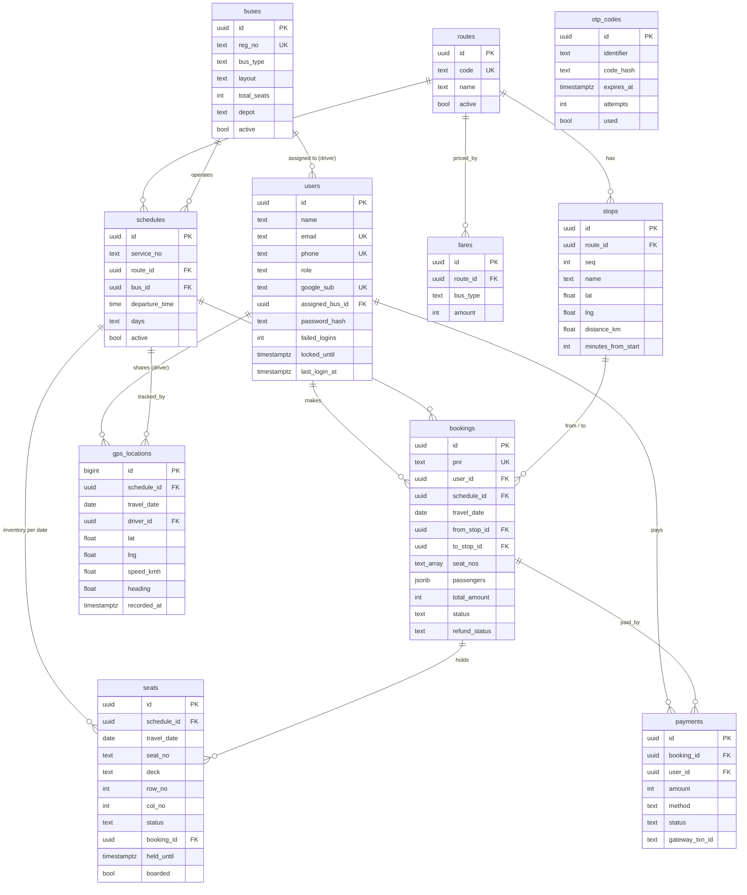

# Database schema

PostgreSQL (Supabase). DDL: [server/src/db/schema.sql](../server/src/db/schema.sql).

## Table notes

| Table | Purpose | Key rules |
|---|---|---|
| `users` | Passengers, drivers/conductors, admins | `role` ∈ passenger / driver / admin. Needs an email or a phone. Drivers are created by admins; `assigned_bus_id` limits which bus they can operate. |
| `otp_codes` | Login codes | Only an HMAC-SHA256 of the code is stored. Valid 5 minutes, max 5 wrong attempts. |
| `routes` | A corridor, e.g. "101 Chennai - Madurai" | Reverse direction is a separate route. |
| `stops` | Ordered stops on a route | `distance_km` and `minutes_from_start` are cumulative from the origin and drive fare, timing and ETA. |
| `buses` | Fleet | `bus_type` ∈ ordinary / express / ac / sleeper; `layout` 2x2, 2x3 or 1x2 (sleeper, two decks). |
| `fares` | Full-route fare per bus type | A partial journey pays in proportion to distance (minimum ₹10). |
| `schedules` | A bus running a route at a time | `days` is the list of weekdays, `0123456` = daily (0 = Sunday). Ordinary buses take ×1.15 longer. |
| `seats` | Seat inventory per trip (schedule + travel date) | Created the first time a trip is opened. `status` ∈ available / held / booked; holds expire after 10 minutes. |
| `bookings` | A ticket (one PNR, up to 6 seats) | `status`: pending_payment → confirmed → cancelled, or → expired. Refund: processing → processed. |
| `payments` | Mock gateway transactions | One row per attempt (success / failed). |
| `gps_locations` | Live positions from the driver's phone | Indexed by trip and time; the latest row is the bus's current position. |
